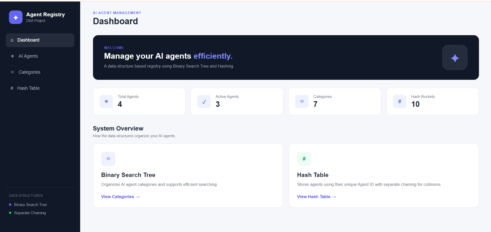
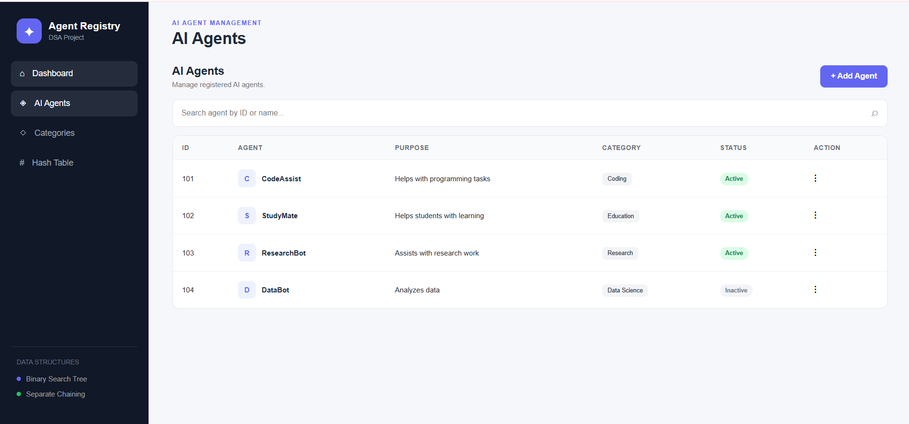
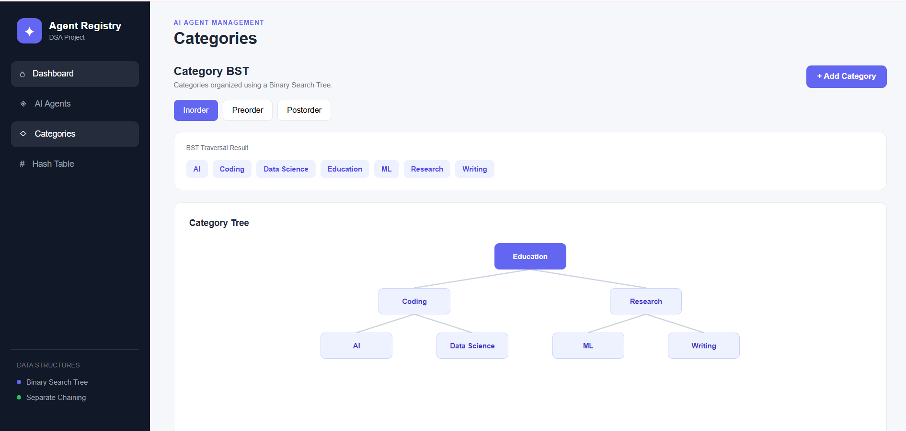
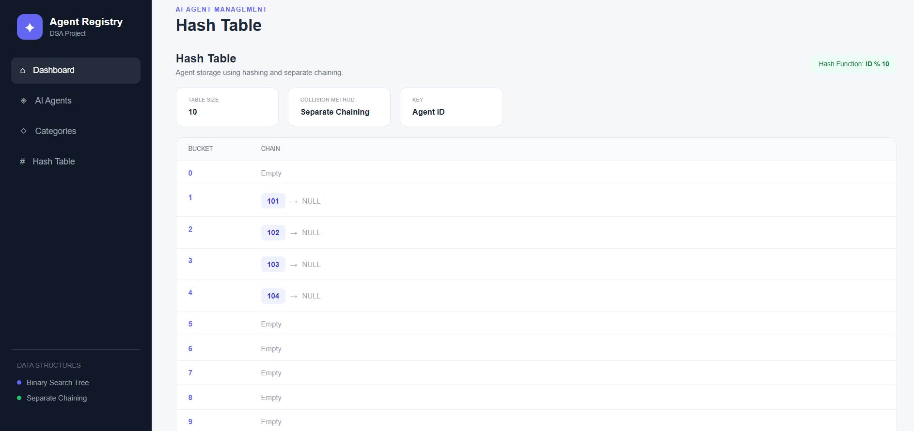

# AI Agent Task Registry Using BST and Hashing

A web-based Data Structures mini project that demonstrates Hashing with Separate Chaining and Binary Search Trees (BST) through an interactive AI-agent management system.

## Project Information

- **Course:** Data Structures – 23CS32C
- **Student:** JEEVIGA M
- **Department:** Computer Science and Engineering
- **Institution:** National Engineering College
- **Academic Year:** 2026–2027

## Overview

This project manages AI-agent records using a Hash Table and organizes agent categories using a Binary Search Tree. It combines a C++ backend with a web interface developed using HTML, CSS, and JavaScript.

## Features

- Add, search, update, and delete AI-agent records.
- Store agents using a Hash Table with Separate Chaining.
- Handle hash collisions using linked lists.
- Add and search categories using a Binary Search Tree.
- Perform inorder, preorder, and postorder traversals.
- Display a visual representation of the BST and hash table.
- View agent and category statistics on the dashboard.

## Data Structures

### Hash Table with Separate Chaining

The hash table stores agent records using their unique IDs.

**Hash function:**

`Hash Index = Agent ID % 10`

For example, `104 % 10 = 4`, so Agent ID 104 maps to bucket 4.

When multiple IDs map to the same bucket, separate chaining stores them in a linked list.

### Binary Search Tree

The BST organizes categories alphabetically.

- **Inorder:** Left → Root → Right
- **Preorder:** Root → Left → Right
- **Postorder:** Left → Right → Root

Inorder traversal displays categories in alphabetical order.

## Technologies Used

- C++
- HTML
- CSS
- JavaScript
- cpp-httplib
- nlohmann/json
- HTTP and JSON communication

## Project Structure

```text
AI-Agent-Task-Registry/
├── backend/
├── frontend/
├── screenshots/
└── README.md
```

## Application Screenshots

### Dashboard



### AI Agent Management



### Binary Search Tree and Traversals



### Hash Table with Separate Chaining



## How to Run

1. Clone or download this repository.
2. Open the project folder in VS Code.
3. Open a terminal in the `backend` folder.
4. Compile the C++ backend using your working compiler command.
5. Run the backend server.
6. Open `frontend/index.html` in your browser.

The frontend connects to the local backend at `http://127.0.0.1:8080`.

## Learning Outcomes

- Implementing a hash table with separate chaining.
- Understanding hash collisions and linked lists.
- Implementing BST insertion and searching.
- Performing tree traversals.
- Connecting a C++ backend with a web-based frontend.

## Conclusion

This project demonstrates the practical application of Hashing and Binary Search Trees in an interactive AI-agent registry.

**Developed by JEEVIGA M**  
Second Year, B.E. Computer Science and Engineering  
National Engineering College
